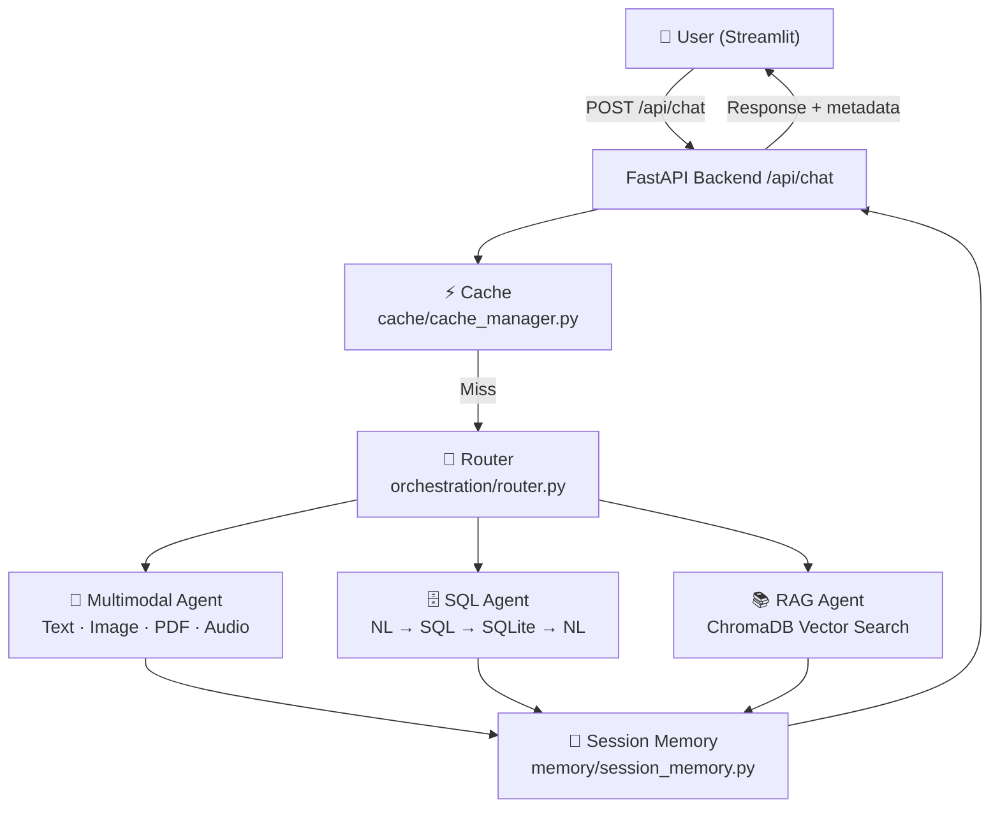

# Multi-Agent Multimodal Chat System

A **beginner-friendly, end-to-end** multi-agent chat application demonstrating:
Multi-Agent Routing · RAG · Text-to-SQL · Session Memory · Caching · FastAPI · Streamlit

---

## Architecture



---

## Project Structure
```
multi_agent_chat_system/
├─ backend/
│  ├─ main.py                    ← FastAPI app entry point
│  ├─ api/
│  │   ├─ routes.py              ← All HTTP endpoints
│  │   └─ schemas.py             ← Pydantic request/response models
│  ├─ agents/
│  │   ├─ multimodal_agent.py    ← Text, image, PDF, audio
│  │   ├─ sql_agent.py           ← NL → SQL → SQLite → NL
│  │   └─ rag_agent.py           ← Vector search + LLM answer
│  ├─ orchestration/
│  │   └─ router.py              ← Routes requests to the right agent
│  ├─ memory/
│  │   └─ session_memory.py      ← Per-session conversation history
│  ├─ cache/
│  │   └─ cache_manager.py       ← TTL in-memory response cache
│  ├─ database/
│  │   ├─ database.py            ← SQLAlchemy engine
│  │   └─ sample_data.py         ← Seeds SQLite with business data
│  ├─ rag/
│  │   ├─ document_loader.py     ← PDF / TXT / DOCX text extraction
│  │   ├─ chunking.py            ← Sliding window text splitter
│  │   └─ vector_store.py        ← ChromaDB ingestion & retrieval
│  └─ config/
│      └─ settings.py            ← Central env-variable config
├─ frontend/
│  └─ app.py                     ← Streamlit UI
├─ tests/
│  ├─ test_router.py
│  ├─ test_sql_agent.py
│  ├─ test_rag_agent.py
│  └─ test_cache.py
├─ data/                         ← SQLite DB + uploaded files (auto-created)
├─ .env.example
├─ requirements.txt
└─ README.md
```

---

## Setup & Running

### 1. Create a virtual environment
```bash
python -m venv .venv
# Windows
.venv\Scripts\activate
# macOS / Linux
source .venv/bin/activate
```

### 2. Install dependencies
```bash
pip install -r requirements.txt
```

### 3. Configure environment variables
```bash
copy .env.example .env   # Windows
cp .env.example .env     # macOS / Linux
```
Edit `.env` and set:
```
OPENAI_API_KEY=sk-...
OPENAI_MODEL=gpt-4o-mini
EMBEDDING_MODEL=text-embedding-3-small
```

### 4. Start the FastAPI backend
```bash
uvicorn backend.main:app --reload
```
API docs → http://127.0.0.1:8000/docs

### 5. Start the Streamlit frontend (new terminal)
```bash
streamlit run frontend/app.py
```
UI → http://localhost:8501

### 6. Run tests
```bash
pytest tests/ -v
```

---

## Agent Workflows

### Multimodal Agent
```
User input (text + optional file)
→ Detect file type (image / PDF / DOCX / TXT / audio)
→ Extract content (Vision API / PyPDF2 / python-docx / Whisper)
→ Assemble prompt
→ LLM (gpt-4o-mini)
→ Answer
```

### SQL Agent
```
Natural language question
→ LLM generates SQLite SELECT query
→ Safety check (reject non-SELECT / dangerous keywords)
→ Execute on business.db
→ LLM converts rows → plain English answer
→ Show SQL + results in UI
```

### RAG Agent
```
User uploads document → Extract text → Split into chunks (800 chars / 150 overlap)
→ Embed chunks (OpenAI text-embedding-3-small) → Store in ChromaDB

User asks question → Embed question → Retrieve top-4 chunks
→ Build prompt with context → LLM answers → Show source chunks in UI
```

### Routing Logic
1. Explicit agent forced by user? → Use it.
2. Image file attached? → Multimodal.
3. Non-image file + RAG docs loaded? → RAG.
4. SQL keywords in question? → SQL (fast regex, no LLM call).
5. RAG keywords + docs loaded? → RAG.
6. Otherwise → lightweight LLM classification call.

---

## Memory vs Cache

| | Session Memory | Cache |
|---|---|---|
| **What** | Per-user conversation thread | Global query → response store |
| **Scope** | One user's session | All users |
| **Expires** | When session is deleted | TTL (default 1 hour) |
| **Purpose** | Give the LLM context | Avoid repeating expensive LLM calls |

---

## Sample Questions to Try

**SQL Agent:**
- "What were total sales last month?"
- "Which product generated the highest revenue?"
- "Show me the top 5 customers by spending."
- "How many employees work in Engineering?"

**Multimodal Agent:**
- "Explain machine learning in simple terms."
- Upload an image → "What is in this image?"

**RAG Agent:**
- Upload a PDF → "Summarize the document."
- "What does the document say about [topic]?"

---

## Future Improvements
- Add Redis for distributed caching across multiple server instances.
- Add streaming responses (SSE / WebSockets) for real-time output.
- Add user authentication and persistent sessions (PostgreSQL).
- Support LangGraph for more complex multi-step agent workflows.
- Add conversation summary memory for very long sessions.
- Deploy with Docker Compose (FastAPI + Streamlit containers).
